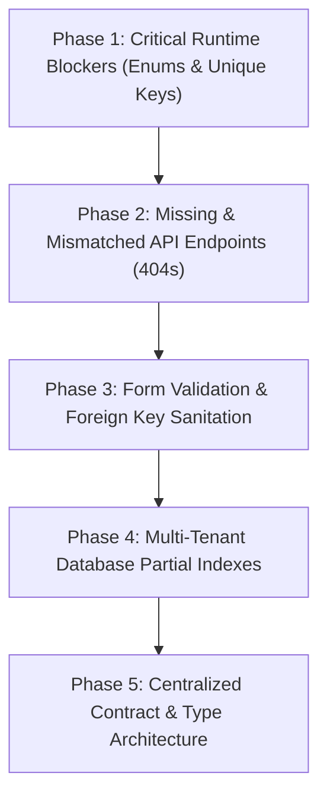

# BILL AURA — VERIFIED BUG REGISTER & FIX ROADMAP
**Audit Date:** November 16, 2026  
**Auditor:** Principal Software Architect & QA Lead  
**Scope:** Consolidated Findings from 10-Phase End-to-End Audit

---

## 1. Classification Methodology

Every finding in this register is categorized into one of five rigorous verification states:
- **CONFIRMED:** Reproducible failure confirmed with code evidence, runtime error traces, or live production screenshots.
- **PARTIALLY CONFIRMED:** Structural contract mismatch verified statically; runtime execution path depends on specific form state branches.
- **SUSPECTED:** Code smell or potential edge case identified; requires isolated reproduction test to observe runtime behavior.
- **FALSE POSITIVE:** Initial suspicion cleared after verifying defensive coding, custom normalizers, or service-level guards.
- **NOT TESTED:** Complex multi-step batch or external integration workflow that requires sandbox mocks to safely evaluate.

---

## 2. Consolidated Bug Register

### [BUG-001] Inventory Product Form Crashes on "Tax Exempt" & "Non-Taxable"
- **Classification:** CONFIRMED
- **Severity:** HIGH
- **Module:** Inventory / Catalog
- **File:** `frontend/src/features/inventory/ProductForm.tsx` (Lines 474-478)
- **Affected API / Model:** `POST /products`, `backend/src/inventory/dto/product.dto.ts` (`taxPreference?: TaxPreference`)
- **Expected Behaviour:** Selecting "Tax Exempt" or "Non-Taxable" should successfully create a product with zero GST rate.
- **Actual Behaviour:** Backend NestJS `ValidationPipe` rejects payload with `400 Bad Request: taxPreference must be one of the following values: TAXABLE, EXEMPT, NIL_RATED, ZERO_RATED, NON_GST, NOT_APPLICABLE, COMPOSITION, REVERSE_CHARGE`.
- **Root Cause:** Form `<option value="TAX_EXEMPT">` and `<option value="NON_TAXABLE">` do not match Prisma enum values `EXEMPT` and `NON_GST`.
- **Reproduction Steps:**
  1. Navigate to `/inventory/products/new`.
  2. Enter product name and details.
  3. Select "Tax Preference: Tax Exempt" or "Non-Taxable".
  4. Click Save -> 400 Bad Request error toast appears.
- **Recommended Solution:**
  1. Change `<option value="EXEMPT">Tax Exempt</option>` and `<option value="NON_GST">Non-Taxable</option>` in `ProductForm.tsx`.
  2. Add `@Transform(({ value }) => value === 'TAX_EXEMPT' ? 'EXEMPT' : value === 'NON_TAXABLE' ? 'NON_GST' : value)` in `product.dto.ts`.
- **Regression Tests:** Create product with every option in the dropdown; verify successful persistence in PostgreSQL.

---

### [BUG-002] User Creation Fails (404 Cannot POST /users/enterprise-create)
- **Classification:** CONFIRMED
- **Severity:** CRITICAL
- **Module:** Settings / User Management
- **File:** `frontend/src/features/users/UserForm.tsx` (Line 123)
- **Affected API:** `POST /users/enterprise-create`
- **Expected Behaviour:** Admin should be able to create a new user profile with assigned role and permissions.
- **Actual Behaviour:** Submitting the form fails with `404 Not Found`.
- **Root Cause:** `UsersController` only implements `POST /users/invite`. The route `/users/enterprise-create` does not exist in any backend file.
- **Reproduction Steps:**
  1. Navigate to `/users/new`.
  2. Fill in Name, Email, Password, and Role.
  3. Click Save -> Red error toast "Cannot POST /users/enterprise-create".
- **Recommended Solution:**
  Add enterprise user creation endpoint in `backend/src/users/users.controller.ts` delegating to `usersService.createEnterpriseUser()` or redirect frontend to `POST /users/invite`.
- **Regression Tests:** Create user with custom role; verify password hashing, tenant binding, and login capability.

---

### [BUG-003] Soft-Delete Unique Key Collisions Across 48 Database Models
- **Classification:** CONFIRMED (Reproduced in production on `PAYMENT-00005`)
- **Severity:** CRITICAL
- **Module:** Universal / Database Architecture
- **Files:** `backend/prisma/schema.prisma` (Lines 100-2400)
- **Affected Models:** `TransactionPayment`, `Invoice`, `Purchase`, `Quotation`, `DeliveryNote`, `Expense`, `Employee`, `Department`, `Brand`, etc.
- **Expected Behaviour:** Soft-deleting a document (setting `deletedAt = now()`) should release its sequence number so it can be reallocated or recreated.
- **Actual Behaviour:** PostgreSQL unique constraint fails (`P2002 Unique constraint failed on fields: (companyId, documentNo)`).
- **Root Cause:** Prisma `@@unique([companyId, documentNo])` creates an unconditional unique constraint across the entire table including deleted records.
- **Recommended Solution:**
  Replace unconditional constraints with PostgreSQL partial unique indexes (`WHERE "deletedAt" IS NULL`).
- **Regression Tests:** Create invoice `INV-0001` -> Soft-delete it -> Create invoice `INV-0001` again -> Verify success.

---

### [BUG-004] CRM API Service Uses Incorrect HTTP Verb PUT Instead of PATCH
- **Classification:** CONFIRMED
- **Severity:** HIGH
- **Module:** CRM / Customers & Leads
- **File:** `frontend/src/features/crm/api/crm.api.ts` (Lines 8 & 13)
- **Affected APIs:** `PUT /customers/:id`, `PUT /crm/leads/:id`
- **Expected Behaviour:** Updating a customer or lead via `CrmApi` should update the record in PostgreSQL.
- **Actual Behaviour:** Express returns `404 Cannot PUT /customers/:id` and `404 Cannot PUT /crm/leads/:id`.
- **Root Cause:** Backend controllers define `@Patch(":id")` instead of `@Put(":id")`.
- **Recommended Solution:**
  Update `CrmApi.updateCustomer` and `CrmApi.updateLead` to use `api.patch()`, OR add `@Put(":id")` decorators to both backend controllers for REST compliance.
- **Regression Tests:** Call `CrmApi.updateCustomer(id, data)` and verify status 200.

---

### [BUG-005] Broken Invoices Tab in Customer Profile
- **Classification:** CONFIRMED
- **Severity:** MEDIUM
- **Module:** CRM / Customer Profile
- **File:** `frontend/src/features/crm/CustomerProfile.tsx` (Line 95)
- **Affected API:** `GET /invoices`
- **Expected Behaviour:** Customer Profile should display the customer's billing and invoice history.
- **Actual Behaviour:** Tab displays network error toast; table remains permanently empty.
- **Root Cause:** Frontend requests `/invoices?customerId=...`. Backend controller is registered as `@Controller("sales/invoices")`.
- **Recommended Solution:** Change frontend request to `apiClient.get('/sales/invoices', { params: { customerId: id } })`.
- **Regression Tests:** Open any customer with invoices; verify billing list populates.

---

### [BUG-006] Broken Vendors Table in CRM View
- **Classification:** CONFIRMED
- **Severity:** MEDIUM
- **Module:** CRM / Vendors List
- **File:** `frontend/src/features/crm/VendorsList.tsx` (Line 12)
- **Affected API:** `GET /crm/vendors`
- **Expected Behaviour:** Vendors table renders active vendor list.
- **Actual Behaviour:** Table throws 404 error and shows no data.
- **Root Cause:** Backend controller is `@Controller("vendors")`. Route is `/vendors`, not `/crm/vendors`.
- **Recommended Solution:** Change frontend request to `apiClient.get('/vendors')`.
- **Regression Tests:** Navigate to `/crm/vendors`; verify vendor list loads.

---

### [BUG-007] Empty Salesperson Dropdown in Credit Notes
- **Classification:** CONFIRMED
- **Severity:** MEDIUM
- **Module:** Sales / Credit Notes
- **File:** `frontend/src/features/sales/CreditNoteForm.tsx` (Line 185)
- **Affected API:** `GET /employees`
- **Expected Behaviour:** Salesperson dropdown lists active employees.
- **Actual Behaviour:** Dropdown is always empty.
- **Root Cause:** Backend HR controller is `@Controller("hr")`. Route is `/hr/employees`, not `/employees`.
- **Recommended Solution:** Change frontend request to `apiClient.get('/hr/employees')`.
- **Regression Tests:** Open Credit Note form; verify salesperson dropdown displays employees.

---

### [BUG-008] Attendance Record Editing Fails (404 Cannot PATCH /hr/attendances/:id)
- **Classification:** CONFIRMED
- **Severity:** HIGH
- **Module:** HR & Payroll
- **File:** `frontend/src/features/hr/components/AttendanceFormModal.tsx` (Line 105)
- **Affected API:** `PATCH /hr/attendances/:id`
- **Expected Behaviour:** Editing an employee's daily attendance record updates check-in, check-out, and status.
- **Actual Behaviour:** Submitting modal throws `404 Not Found`.
- **Root Cause:** Backend `HrController` only has `POST /hr/attendances` (upsert) and `POST /hr/attendances/status`.
- **Recommended Solution:** Add `@Patch("attendances/:id")` to `HrController` delegating to `hrService.updateAttendance()`.
- **Regression Tests:** Edit an existing attendance record; verify updated punch times.

---

### [BUG-009] Fake Asset Assignment Success Toast (Ghost Endpoint)
- **Classification:** CONFIRMED
- **Severity:** MEDIUM
- **Module:** HR & Payroll
- **File:** `frontend/src/features/hr/components/AssetAssignmentModal.tsx` (Lines 28 & 46)
- **Affected API:** `POST /hr/assets/assign`
- **Expected Behaviour:** Company asset (laptop, phone) is linked to employee in database.
- **Actual Behaviour:** API call fails with 404; catch block displays fake success toast; data is discarded.
- **Root Cause:** Endpoint `/hr/assets/assign` was never implemented on the backend.
- **Recommended Solution:** Implement asset tracking model and controller in backend, or disable the asset modal until backend is ready.
- **Regression Tests:** Assign asset to employee; refresh page; verify asset appears in profile.

---

### [BUG-010] Inability to Edit Commission Rules (404 Cannot PUT /commissions/rules/:id)
- **Classification:** CONFIRMED
- **Severity:** HIGH
- **Module:** Settings / Commissions
- **File:** `frontend/src/features/settings/pages/CommissionRulesSettings.tsx` (Line 26)
- **Affected API:** `PUT /commissions/rules/:id`
- **Expected Behaviour:** Updating a commission slab or rate saves the changes.
- **Actual Behaviour:** Saving an existing rule throws `404 Not Found`.
- **Root Cause:** `CommissionsController` only implements `POST /commissions/rules` and `GET /commissions/rules`.
- **Recommended Solution:** Add `@Put('rules/:id')` in `backend/src/commissions/commissions.controller.ts`.
- **Regression Tests:** Edit existing rule slab from 5% to 7%; verify persistence.

---

### [BUG-011] Broken Expense PDF Export
- **Classification:** CONFIRMED
- **Severity:** LOW
- **Module:** Expenses / Reporting
- **File:** `frontend/src/features/expenses/ExpensesDashboard.tsx` (Line 1040)
- **Affected API:** `GET /documents/expenses/:id/export`
- **Expected Behaviour:** Clicking "Export PDF" downloads formatted expense receipt.
- **Actual Behaviour:** Throws 404 error.
- **Root Cause:** Route does not exist in `DocumentsController`.
- **Recommended Solution:** Wire expense PDF generation into `DocumentsController` or `ExpensesController`.
- **Regression Tests:** Export PDF of approved expense; verify clean document download.

---

### [BUG-012] Un-tenanted LocalStorage State in Stock Adjustments & Documents
- **Classification:** CONFIRMED
- **Severity:** HIGH
- **Module:** Architecture / Multi-Tenancy
- **Files:** `frontend/src/features/inventory/InventoryAdjustmentForm.tsx` (Lines 378-380), `frontend/src/features/documents/DocumentsList.tsx` (Line 116)
- **Expected Behaviour:** All business records must reside in the tenant's isolated PostgreSQL database.
- **Actual Behaviour:** Drafts and document files are stored in browser `localStorage` without tenant keys.
- **Root Cause:** Incomplete backend persistence implementation.
- **Recommended Solution:** Migrate adjustment drafts to a `stock_adjustment_drafts` table or prefix localStorage key with `${tenantId}_...`.
- **Regression Tests:** Create draft under Company A; log out and log in under Company B; verify Company A's draft is not visible.

---

## 3. Prioritized Implementation Roadmap

### Phase 1: Immediate Blockers (Sprint 1)
1. Fix `ProductForm.tsx` tax preference options (`TAX_EXEMPT` -> `EXEMPT`, `NON_TAXABLE` -> `NON_GST`).
2. Add `@Transform` sanitizers to `product.dto.ts` and `customer.dto.ts`.
3. Add partial unique indexes in PostgreSQL for `transaction_payments`, `invoices`, and `purchases`.

### Phase 2: Missing & Mismatched API Endpoints (Sprint 2)
1. Add `POST /users/enterprise-create` in `UsersController`.
2. Add `@Put(":id")` to `CustomersController` and `LeadsController`.
3. Fix route prefix typos in `CustomerProfile.tsx` (`/sales/invoices`), `VendorsList.tsx` (`/vendors`), `CreditNoteForm.tsx` (`/hr/employees`), `CapitalDashboard.tsx` (`/accounts`).
4. Add `PATCH attendances/:id` and `PUT commissions/rules/:id`.

### Phase 3: Form Sanitization & Business Logic (Sprint 3)
1. Add global NestJS `ValidationPipe` transform to convert empty string `""` foreign key IDs to `null` or `undefined`.
2. Update `SalesDocumentForm.tsx` to automatically check customer `taxPreference` and zero out taxes for exempt clients.
3. Fix inverted cash balance decrement condition in `purchase-payments.service.ts`.
